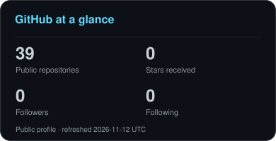
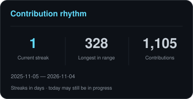
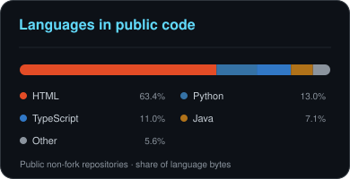

<h1 align="center">
  
</h1>

<h3 align="center">Computer Science master's student · Backend &amp; full-stack development</h3>

  🎓 <strong>Stevens Institute of Technology</strong> · Expected graduation: December 2026 
  🔭 Exploring APIs, reliable background jobs, search, and web applications 
  🌱 Building hands-on coding and debugging skills through personal projects 
  💼 Interested in entry-level backend and full-stack software roles

  
  

[Visit my portfolio](https://abhijith-viswanathan-portfolio.abhijithabhi3331.chatgpt.site/) · [Download my resume](https://abhijith-viswanathan-portfolio.abhijithabhi3331.chatgpt.site/assets/Abhijith-Viswanathan-Resume.pdf) · [Selected project guide](PORTFOLIO.md)

My internship background includes Node.js authentication with Azure Active Directory at **Xurmo Technologies** and API development for a real estate client at **Voila Ingenious**.

At **Cambridge Institute of Technology**, I headed cultural activities, coordinating student teams and hosting college festivals and cultural programs with **more than 3,000 student participants at each event**. This experience developed my communication, team-building and event-coordination skills.

<!-- github-project-categories:start -->
## Projects by category

Choose a section below to explore that area on GitHub. Each directory groups related repositories with descriptions, setup links and recorded evidence.

| Project area | What is inside | Open category |
|---|---|---|
| **[Data Analytics](https://github.com/abhijith-abhii/abhijith-abhii/tree/main/projects/data-analytics)** | SQL · Dashboards · A/B testing · Public-data research | [5 projects →](https://github.com/abhijith-abhii/abhijith-abhii/tree/main/projects/data-analytics) |
| **[AI & ML Engineering](https://github.com/abhijith-abhii/abhijith-abhii/tree/main/projects/ai-ml-engineering)** | Retrieval · Local models · Evaluation · Guardrails | [5 projects →](https://github.com/abhijith-abhii/abhijith-abhii/tree/main/projects/ai-ml-engineering) |
| **[Data Science & Machine Learning](https://github.com/abhijith-abhii/abhijith-abhii/tree/main/projects/data-science-ml)** | Regression · Classification · Clustering · Fine-tuning | [5 projects →](https://github.com/abhijith-abhii/abhijith-abhii/tree/main/projects/data-science-ml) |
| **[Data Engineering](https://github.com/abhijith-abhii/abhijith-abhii/tree/main/projects/data-engineering)** | Data contracts · Validation · Ingestion | [1 project →](https://github.com/abhijith-abhii/abhijith-abhii/tree/main/projects/data-engineering) |
| **[Software Engineering](https://github.com/abhijith-abhii/abhijith-abhii/tree/main/projects/software-engineering)** | APIs · SQLite · Collaboration · Browser extensions | [9 projects →](https://github.com/abhijith-abhii/abhijith-abhii/tree/main/projects/software-engineering) |
| **[Cloud & DevOps](https://github.com/abhijith-abhii/abhijith-abhii/tree/main/projects/cloud-devops)** | Docker · Terraform · CI · Kubernetes · Reliability | [5 projects →](https://github.com/abhijith-abhii/abhijith-abhii/tree/main/projects/cloud-devops) |
| **[Cybersecurity & Secure Systems](https://github.com/abhijith-abhii/abhijith-abhii/tree/main/projects/cybersecurity)** | Access restrictions · Container hardening · Network isolation | [3 security-related projects →](https://github.com/abhijith-abhii/abhijith-abhii/tree/main/projects/cybersecurity) |

**36 public project repositories, including six embedded systems and Raspberry Pi AI projects.** The Cybersecurity & Secure Systems section cross-lists three projects with security controls. The original 25-project collection is included alongside Global Health Passport, Durable Queue, Contract Pipeline, PropertyPulse and RescueRoute.

[Open the complete GitHub project directory](https://github.com/abhijith-abhii/abhijith-abhii/tree/main/projects)
<!-- github-project-categories:end -->

<!-- embedded-projects:start -->
## Embedded systems and Raspberry Pi AI

Six AI-assisted personal projects now include downloadable source, simulation evidence, measured comparisons, failure logs and hardware validation plans on my portfolio. Physical deployment remains pending.

| Project | Evidence | Case study |
|---|---|---|
| [Machine condition monitor](https://github.com/abhijith-abhii/condition-monitor) | ESP32 cross-compilation and host signal tests | [Open](https://abhijith-viswanathan-portfolio.abhijithabhi3331.chatgpt.site/projects/condition-monitor/) |
| [Environmental data logger](https://github.com/abhijith-abhii/environment-logger) | Persistent retry and deduplication simulation | [Open](https://abhijith-viswanathan-portfolio.abhijithabhi3331.chatgpt.site/projects/environment-logger/) |
| [Equipment pulse recorder](https://github.com/abhijith-abhii/pulse-recorder) | Elapsed-time RPM and timer-wrap regression | [Open](https://abhijith-viswanathan-portfolio.abhijithabhi3331.chatgpt.site/projects/pulse-recorder/) |
| [Classroom occupancy and lighting](https://github.com/abhijith-abhii/classroom-lighting-ai) | Person F1 0.632 → 0.736 on 78 images; conservative lighting trace | [Open](https://abhijith-viswanathan-portfolio.abhijithabhi3331.chatgpt.site/projects/classroom-lighting-ai/) |
| [Parking occupancy and gate](https://github.com/abhijith-abhii/parking-gate-ai) | Vehicle F1 0.386 → 0.581; virtual obstruction interlock | [Open](https://abhijith-viswanathan-portfolio.abhijithabhi3331.chatgpt.site/projects/parking-gate-ai/) |
| [Waste sorting and bin monitor](https://github.com/abhijith-abhii/waste-sorting-ai) | Known-material accuracy 62.17% → 90.27% on 452 images | [Open](https://abhijith-viswanathan-portfolio.abhijithabhi3331.chatgpt.site/projects/waste-sorting-ai/) |

The Raspberry Pi projects use real pretrained inference; the waste classifier includes a trained linear head. Unknown waste rejection was only 4/21, and the conservative classroom policy increased estimated lighting energy on the scripted trace. Reports distinguish these limitations from the improvements. Each project name above links to its public GitHub repository; reports and source downloads are also available from the case studies.
<!-- embedded-projects:end -->

---

<h2 align="center">⚒️ Languages &amp; tools in my projects</h2>

   
  

## How I am learning

Certification: **AWS Certified Solutions Architect – Professional**.

I build personal projects across full-stack development, search, cloud systems and optimization. My repositories include working examples, tests, design decisions and reproducible benchmarks. See each project’s development notes for tools and implementation details.

The health platform is a synthetic prototype, without live patient deployment or compliance certification. The portfolio does not claim production adoption or independently implemented expertise that has not been demonstrated.

---

<h2 align="center">🐍 Contribution snake</h2>

  <picture>
    <source media="(prefers-color-scheme: dark)" srcset="https://raw.githubusercontent.com/abhijith-abhii/abhijith-abhii/output/github-snake-dark.svg" />
    <source media="(prefers-color-scheme: light)" srcset="https://raw.githubusercontent.com/abhijith-abhii/abhijith-abhii/output/github-snake.svg" />
    
  </picture>

<h2 align="center">⚡ GitHub activity</h2>

  
   
  

---

  

## Connect

[LinkedIn — Abhijith Viswanathan](https://www.linkedin.com/in/abhijith-viswanathan-0a7216436/)

